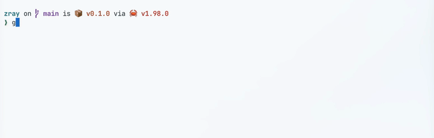

# zray

Interactive history search for zsh. You can perform a fuzzy search on your
command history or directory history, then select an item to execute it or
insert it into the prompt.



History is kept in its own SQLite database, separate from `$HISTFILE`, along
with the exit code, duration and working directory of every run. Ranking uses
those: recent, frequent, successful commands and commands you have run in the
current directory rank higher.

## Install

Requires a Rust toolchain.

```sh
cargo install --path .
```

Add this to `~/.zshrc`, after anything that sets your prompt (such as
`starship init`):

```zsh
eval "$(zray init zsh)"
```

Plugin managers can load `zray.plugin.zsh` instead, but it does the same thing
and still needs the `zray` binary on `$PATH`.

Then import your existing history once:

```sh
zray import            # reads $HISTFILE, or ~/.zsh_history
zray import path/to/history
```

Importing the same file again adds nothing.

## Usage

Press <kbd>Up</kbd> at the prompt. Whatever is already typed becomes the
initial query. In a multi-line buffer, <kbd>Up</kbd> moves the cursor as usual
until it is on the first line.

| Key | Action |
| --- | --- |
| <kbd>Enter</kbd> | Run the selected command, or change to the selected directory |
| <kbd>Right</kbd> / <kbd>Ctrl-F</kbd> at the end of the query | Put the selection in the edit buffer |
| <kbd>Tab</kbd> | Switch between commands and directories |
| <kbd>Up</kbd> / <kbd>Ctrl-P</kbd> | Move the selection up |
| <kbd>Down</kbd> / <kbd>Ctrl-N</kbd> | Move the selection down |
| <kbd>Page Up</kbd> / <kbd>Page Down</kbd> | Move the selection by a screenful |
| Mouse wheel | Scroll the list |
| Click | Select a candidate, or switch to a tab |
| <kbd>Esc</kbd> | Go back to the query the search opened with / close |
| <kbd>Ctrl-C</kbd> / <kbd>Ctrl-G</kbd> | Close |
| <kbd>Ctrl-W</kbd> / <kbd>Ctrl-U</kbd> / <kbd>Ctrl-K</kbd> | Delete word / to start / to end |
| <kbd>Ctrl-A</kbd> / <kbd>Ctrl-E</kbd>, arrows | Move the cursor in the query |
| <kbd>Option-Left</kbd> / <kbd>Option-Right</kbd> | Move the cursor by word (also <kbd>Ctrl</kbd> with the arrows, <kbd>Alt-B</kbd> / <kbd>Alt-F</kbd>) |
| <kbd>Option-Backspace</kbd> / <kbd>Alt-D</kbd> | Delete the word before / after the cursor |

Closing leaves the edit buffer as it was. With an empty query the list is
newest first, so <kbd>Up</kbd> <kbd>Enter</kbd> reruns the last command. When
nothing matches, <kbd>Enter</kbd> puts the query text in the edit buffer
rather than running it.

The query uses fzf-style syntax: space-separated terms must all match,
`'term` matches exactly, `^term` and `term$` anchor, `!term` excludes.
Matching is case-insensitive unless the query contains an uppercase letter.

### Directories

The directories tab lists the directories you have entered or run commands
in, most recent first, as absolute paths. It is filtered by the same query as
the commands tab, and the query stays as you switch. Directories that no
longer exist and the one you are in are left out.

<kbd>Enter</kbd> changes to the selected directory in place: no `cd` command
is run, so nothing is added to your history and the edit buffer is untouched.
<kbd>Right</kbd> puts the path, quoted, in the edit buffer instead.

### What the list shows

Each command shows how long ago it last ran on the right, with up to two
marks in fixed columns before that:

| Mark | Meaning |
| --- | --- |
| `✗` | The last run failed (a non-zero exit, other than 130 from <kbd>Ctrl-C</kbd>) |
| `⌂` | It has been run in the current directory |

## Configuration

Set these in `~/.zshrc` before the `eval` line.

| Variable | Default | Effect |
| --- | --- | --- |
| `ZRAY_MAX_ITEMS` | `10` | The most candidates shown at once. Must be exported. |
| `ZRAY_PROMPT` | last line of `$PROMPT` | Text shown before the query. |
| `ZRAY_NO_BIND` | unset | If set, <kbd>Up</kbd> is not bound. Bind the `zray-search` widget yourself. |
| `ZRAY_DB` | `$XDG_DATA_HOME/zray/history.db`, or `~/.local/share/zray/history.db` | Location of the database. Must be exported. |
| `ZRAY_THEME` | built-in theme | Color overrides, see [Theme](#theme). Must be exported. |

To use a different key:

```zsh
ZRAY_NO_BIND=1
eval "$(zray init zsh)"
bindkey '^R' zray-search
```

## Theme

Colors are named by what they are used for. `ZRAY_THEME` is a list of
`token=color` pairs, separated by commas or spaces, that override the
built-in theme. Tokens you leave out keep their default.

```zsh
export ZRAY_THEME='match=#ffb454,marker=#59c2ff,selected-bg=#1f2430,muted=244'
```

| Token | Used for | Default |
| --- | --- | --- |
| `text` | Commands in the list | `default` |
| `selected` | The selected command and its age (always bold) | `default` |
| `selected-bg` | Background of the selected row | `default` |
| `match` | Characters the query matched | `yellow` |
| `marker` | The bar marking the selected row | `cyan` |
| `muted` | Ages of the other commands, the selected command's last run, and the `…` of a cut-off command | `bright-black` |
| `error` | The `✗` mark, and a non-zero exit code in the last run | `red` |
| `here` | The `⌂` mark | `blue` |
| `query` | The text you type | `default` |
| `tab-active` | The name of the tab being shown (always bold) | `bright-white` |
| `tab-active-bg` | The block behind the name of the tab being shown | `black` |
| `tab` | The names of the other tabs | `bright-black` |

A color is one of:

- a hex value, `#rrggbb` or `#rgb`
- an ANSI color name: `black`, `red`, `green`, `yellow`, `blue`, `magenta`,
  `cyan`, `white`, each also as `bright-…` (`gray` is `bright-black`)
- a 256-color index, `0` to `255`
- `default`, the terminal's own foreground or background

The built-in theme uses only ANSI names, so it follows your terminal's color
scheme. Hex values need a terminal with 24-bit color.

`zray theme` prints the theme in effect with a sample of each color, and
reports entries in `ZRAY_THEME` it could not understand. The search itself
skips such entries silently.

## What gets recorded

Every command you run, from the moment the integration is loaded. Commands
starting with a space are skipped when `HIST_IGNORE_SPACE` is set. zsh's own
history is left untouched.

Every directory the shell enters, and the directory each command is run in.

## Limitations

- While the search is open it receives mouse clicks and the wheel, so
  selecting text with the mouse needs your terminal's override (usually
  holding <kbd>Option</kbd> or <kbd>Shift</kbd>).
- Right-side prompts and transient prompts are not handled.

## License

[MIT](LICENSE)
